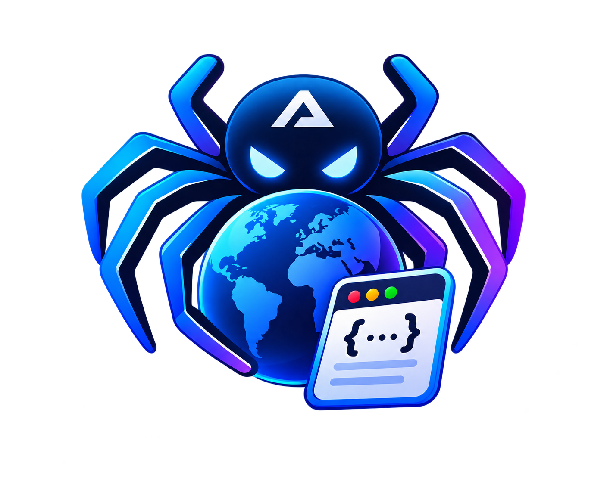
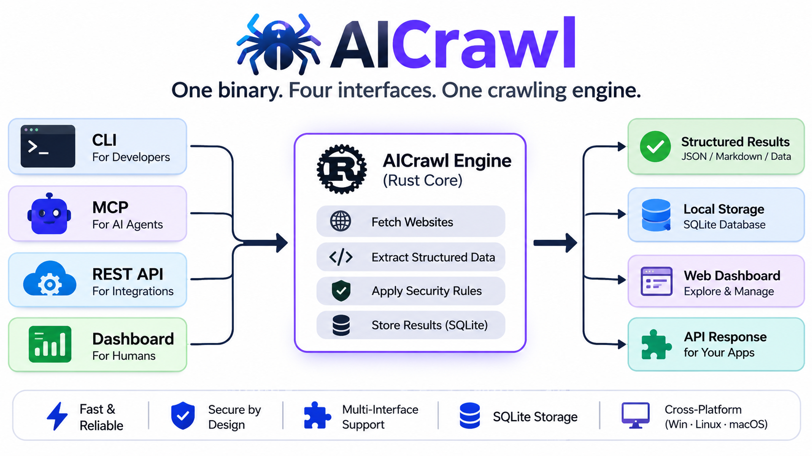

> **Note:** this translation predates v1.0.0 (JSON-first requests, no AI provider).
> See [README.md](README.md) and [docs/request-schema.md](docs/request-schema.md) for current behaviour.

<div align="center">



# AICrawl

**Eén uitvoerbaar bestand waarmee AI-agenten en mensen toegestane websites kunnen crawlen en gestructureerde data kunnen extraheren.**

[](https://github.com/Ahaduzzamankhan/aicrawl/actions/workflows/ci.yml)
[](https://github.com/Ahaduzzamankhan/aicrawl/releases)
[](https://github.com/Ahaduzzamankhan/aicrawl/releases)
[](https://github.com/Ahaduzzamankhan/aicrawl/releases)
[](LICENSE)
[](https://www.rust-lang.org/)
[](https://modelcontextprotocol.io)
[](CONTRIBUTING.md)

**Lees dit in:** [English](README.md) · [বাংলা](README.bn.md) · [हिन्दी](README.hi.md) · [Español](README.es.md) · [Nederlands](README.nl.md) · [简体中文](README.zh-CN.md) · [日本語](README.ja.md) · [Русский](README.ru.md)

[Installeren](#install-one-line) · [Snel starten](#snel-starten) · [Download](#download) · [MCP-server](#ai-agenten-mcp) · [REST API](#rest-api) · [Dashboard](#dashboard) · [Bijdragen](CONTRIBUTING.md) · [Beveiliging](SECURITY.md)

</div>

Eén uitvoerbaar bestand waarmee **AI-agenten** en **mensen** toegestane websites kunnen crawlen en gestructureerde data kunnen extraheren.

> **Experimentele release:** de huidige versie staat in [`version.json`](version.json). Interfaces en opslag kunnen tussen experimentele builds veranderen; gebruik het nog niet voor onbeheerd crawlen in productie.

Vooraf gebouwde binaries voor **Windows x64, Linux x64, macOS Intel en macOS Apple Silicon** worden bij elke [release](https://github.com/Ahaduzzamankhan/aicrawl/releases) gevoegd, samen met SHA-256-checksums.

Eén `aicrawl`-binary bevat:

| Oppervlak | Wie gebruikt het | Hoe |
| --- | --- | --- |
| CLI | mensen en scripts | `aicrawl extract`, `crawl`, `inspect`, `jobs`, … |
| Dashboard | mensen | React-UI geserveerd door `aicrawl start` op `http://127.0.0.1:8080` |
| REST API | scripts en integraties | `http://127.0.0.1:8080/api/v1` |
| MCP-server | AI-agenten | `aicrawl mcp stdio` of `http://127.0.0.1:8787/mcp` |

<p align="center">
  
</p>

Het dashboard is **in het uitvoerbare bestand ingebouwd**; er is geen aparte webserver en geen assetmap om te versturen. Alle vier oppervlakken gebruiken dezelfde `AicrawlEngine`, dus SSRF-bescherming, robots.txt-afhandeling, caching en opslag gedragen zich identiek.

AICrawl bevat **geen AI-model en geen API-sleutels**. Deterministische extractie werkt direct. Als je een extern OpenAI-compatibel endpoint of een lokale Ollama-server configureert, wordt semantische extractie beschikbaar; anders retourneert MCP de opgeschoonde pagina-inhoud en gestructureerde hints waarover de aanroepende agent kan redeneren.

## Install (one line)

Downloadt de nieuwste release voor je platform, verifieert de SHA-256-checksum, installeert deze en voegt deze toe aan `PATH` (`%LOCALAPPDATA%\AICrawl\bin` op Windows, `~/.local/bin` op macOS en Linux).

**PowerShell 7 (Windows, macOS, Linux)**

```powershell
$ProgressPreference='SilentlyContinue';[Net.ServicePointManager]::SecurityProtocol=[Net.SecurityProtocolType]::Tls12;$b='https://github.com/Ahaduzzamankhan/aicrawl/releases/latest/download';$win=$env:OS -eq 'Windows_NT';if($win){$f='aicrawl-windows-x64.exe';$x='aicrawl.exe';$d=Join-Path $env:LOCALAPPDATA 'AICrawl\bin'}else{$s=(& uname -s);$m=(& uname -m);if($s -eq 'Darwin' -and $m -eq 'arm64'){$f='aicrawl-macos-arm64'}elseif($s -eq 'Darwin'){$f='aicrawl-macos-x64'}elseif($s -eq 'Linux' -and $m -eq 'x86_64'){$f='aicrawl-linux-x64'}else{throw "Unsupported platform: $s $m"};$x='aicrawl';$d=Join-Path $HOME '.local/bin'};$null=New-Item -ItemType Directory -Force $d;$null=Invoke-WebRequest "$b/$f" -OutFile (Join-Path $d $x) -UseBasicParsing;$null=Invoke-WebRequest "$b/$f.sha256" -OutFile (Join-Path $d "$x.sha256") -UseBasicParsing;if((Get-Content (Join-Path $d "$x.sha256") -TotalCount 1).Split()[0] -ne (Get-FileHash (Join-Path $d $x) -Algorithm SHA256).Hash.ToLower()){throw 'AICrawl checksum mismatch'};if($win){$p=[Environment]::GetEnvironmentVariable('Path','User');if(-not $p){$p=''};if(($p -split ';') -notcontains $d){[Environment]::SetEnvironmentVariable('Path',($p.TrimEnd(';')+';'+$d).Trim(';'),'User')};$sep=';'}else{chmod +x (Join-Path $d $x);$rc=if($env:SHELL -like '*zsh'){Join-Path $HOME '.zshrc'}elseif($env:SHELL -like '*bash'){Join-Path $HOME '.bashrc'}else{Join-Path $HOME '.profile'};if(-not (Test-Path $rc)){New-Item -ItemType File -Force $rc|Out-Null};if(-not (Select-String -Path $rc -SimpleMatch $d -Quiet)){Add-Content $rc "`nexport PATH=`"$d`:`$PATH`""};$sep=':'};$env:Path=$d+$sep+$env:Path;& (Join-Path $d $x) --version
```

**Windows CMD**

```bat
powershell -NoProfile -ExecutionPolicy Bypass -Command "$ProgressPreference='SilentlyContinue';[Net.ServicePointManager]::SecurityProtocol=[Net.SecurityProtocolType]::Tls12;$d=Join-Path $env:LOCALAPPDATA 'AICrawl\bin';$u='https://github.com/Ahaduzzamankhan/aicrawl/releases/latest/download/aicrawl-windows-x64.exe';$null=New-Item -ItemType Directory -Force $d;$null=Invoke-WebRequest $u -OutFile (Join-Path $d 'aicrawl.exe') -UseBasicParsing;$null=Invoke-WebRequest ($u+'.sha256') -OutFile (Join-Path $d 'aicrawl.exe.sha256') -UseBasicParsing;if((Get-Content (Join-Path $d 'aicrawl.exe.sha256') -TotalCount 1).Split()[0] -ne (Get-FileHash (Join-Path $d 'aicrawl.exe') -Algorithm SHA256).Hash.ToLower()){throw 'AICrawl checksum mismatch'};$p=[Environment]::GetEnvironmentVariable('Path','User');if(-not $p){$p=''};if(($p -split ';') -notcontains $d){[Environment]::SetEnvironmentVariable('Path',($p.TrimEnd(';')+';'+$d).Trim(';'),'User')};$env:Path=$d+';'+$env:Path;aicrawl --version"
```

**macOS / Linux**

```sh
(d="$HOME/.local/bin";b="https://github.com/Ahaduzzamankhan/aicrawl/releases/latest/download";case "$(uname -s):$(uname -m)" in Darwin:arm64)f=aicrawl-macos-arm64;;Darwin:x86_64)f=aicrawl-macos-x64;;Linux:x86_64)f=aicrawl-linux-x64;;*)echo "Unsupported platform: $(uname -s) $(uname -m)" >&2;exit 1;;esac;t=$(mktemp -d)||exit 1;trap 'rm -rf "$t"' EXIT;curl -fsSL "$b/$f" -o "$t/$f"||exit 1;curl -fsSL "$b/$f.sha256" -o "$t/$f.sha256"||exit 1;(cd "$t"&&if command -v sha256sum >/dev/null 2>&1;then sha256sum -c "$f.sha256";else shasum -a 256 -c "$f.sha256";fi)||exit 1;mkdir -p "$d"||exit 1;cp "$t/$f" "$d/aicrawl"||exit 1;chmod +x "$d/aicrawl"||exit 1;rc="$HOME/.profile";case "${SHELL:-}" in *zsh)rc="$HOME/.zshrc";;*bash)rc="$HOME/.bashrc";;esac;touch "$rc";grep -qsF "$d" "$rc"||printf '\nexport PATH="%s:$PATH"\n' "$d">>"$rc";PATH="$d:$PATH";"$d/aicrawl" --version)
```

Open een nieuwe terminal en voer `aicrawl --version` uit.

## Download

Bij elke [release](https://github.com/Ahaduzzamankhan/aicrawl/releases) zijn vooraf gebouwde binaries gevoegd. Open de nieuwste release en download het bestand voor jouw platform:

| Platform | Bestand |
| --- | --- |
| Windows x64 | `aicrawl-windows-x64.exe` |
| Linux x64 | `aicrawl-linux-x64` |
| macOS Intel (x64) | `aicrawl-macos-x64` |
| macOS Apple Silicon (arm64) | `aicrawl-macos-arm64` |

Elke binary heeft een bijbehorend `.sha256`-checksumbestand. Controleer dit voordat je het uitvoert:

```bash
# Linux
sha256sum -c aicrawl-linux-x64.sha256

# macOS
shasum -a 256 -c aicrawl-macos-arm64.sha256
```

```powershell
# Windows
Get-FileHash .\aicrawl-windows-x64.exe -Algorithm SHA256
```

Maak de Unix-binaries na het downloaden uitvoerbaar:

```bash
chmod +x aicrawl-linux-x64 aicrawl-macos-arm64
```

De binaries zijn zelfstandig: dashboard, migraties en SQLite zijn meegecompileerd. Alleen optionele JavaScript-rendering heeft externe software nodig.

## Snel starten

```bash
# 1. Bouw het dashboard en sluit het daarna in de binary in
cd frontend && npm ci && npm run build && cd ..
cargo build --release

# 2. Start API + dashboard + MCP (één proces)
./target/release/aicrawl start

# 3. Gebruik het
./target/release/aicrawl extract https://example.com --query "Extract the page title and main headings"
./target/release/aicrawl inspect https://example.com
./target/release/aicrawl crawl https://example.com --max-pages 20 --max-depth 2 --query "Extract product prices"
```

De eerste `start` opent `~/.aicrawl/aicrawl.db` (SQLite) en toont de URL's van dashboard, API en MCP. Stel `AICRAWL_DATA_DIR` in of geef `--data-dir` mee om een andere locatie te gebruiken.

```bash
aicrawl start --daemon      # achtergrondproces, log in <data-dir>/aicrawl.log
aicrawl status
aicrawl stop
```

## AI-agenten (MCP)

### stdio — aanbevolen voor desktopagenten

Wijs de agent naar hetzelfde uitvoerbare bestand:

```json
{
  "mcpServers": {
    "aicrawl": {
      "command": "C:\\path\\to\\aicrawl.exe",
      "args": ["mcp", "stdio"]
    }
  }
}
```

### Streamable HTTP

Voer `aicrawl start` (of `aicrawl mcp start`) uit en gebruik:

```json
{
  "mcpServers": {
    "aicrawl": {
      "url": "http://127.0.0.1:8787/mcp"
    }
  }
}
```

Tools:

- `extract_website_data` — `url`, `query`, optioneel `schema`, `output_format`
- `crawl_website` — `url`, `max_pages`, `max_depth`
- `get_page_content` — `url`
- `inspect_website` — `url`
- `search_website` — `url`, `query`
- `get_crawl_result` — `job_id`
- `get_crawl_status` — `job_id`

Pagina-inhoud wordt als **niet-vertrouwde data** behandeld. Tool-uitvoer markeert dit als zodanig en volgt nooit instructies die op webpagina's worden gevonden.

## Mensen

### CLI

```text
aicrawl start [--api-port 8080] [--mcp-port 8787] [--daemon]
aicrawl stop | status
aicrawl extract <url> --query <text> [--schema <file|json>] [--format json|markdown|text]
                       [--no-ai] [--render] [--no-cache]
aicrawl crawl <url> [--max-pages N] [--max-depth N] [--query <text>] [--render]
aicrawl inspect <url> [--render]
aicrawl mcp start [--port 8787] | aicrawl mcp stdio
aicrawl api start [--port 8080]
aicrawl jobs [--status <status>] [--limit N]
aicrawl results [--job <id>] [--limit N] [--full]
aicrawl config show | set <key> <value> | path
aicrawl doctor [--offline]
aicrawl version
```

Algemene opties: `--no-color` (respecteert ook `NO_COLOR`), `--config <path>`, `--data-dir <dir>`.

### Dashboard

Open `http://127.0.0.1:8080` na `aicrawl start`:

- **Overview** — gezondheid, tellers voor jobs/resultaten, recente activiteit
- **New Extraction** — URL, query, schema, formaat, render-schakelaar
- **Crawl Jobs** — live status, voortgang, annuleren, jobdetails
- **Results Explorer** — opgeslagen resultaten met JSON-viewer en kopiëren/downloaden
- **MCP Configuration** — klaar-om-te-kopiëren stdio/HTTP-configuraties en tooloverzicht
- **API Keys** — sleutels aanmaken/intrekken (eenmalig getoond, gehasht opgeslagen)
- **AI Providers** — optionele externe providers, sleutels versleuteld op schijf
- **Settings** — effectieve beveiligingslimieten, cache- en opslaginstellingen

### REST API

Alle antwoorden gebruiken `{ "success": true, "data": … }` of `{ "success": false, "error": { "code", "message", "retryable" } }`.

```bash
curl -s http://127.0.0.1:8080/api/v1/health

curl -s -X POST http://127.0.0.1:8080/api/v1/extract \
  -H 'content-type: application/json' \
  -d '{"url":"https://example.com","query":"Extract the main headings","use_ai":false}'

curl -s -X POST http://127.0.0.1:8080/api/v1/crawl \
  -H 'content-type: application/json' \
  -d '{"url":"https://example.com","max_pages":10,"max_depth":1}'
```

Stel `[api].require_api_key = true` in (of bind buiten loopback) en stuur `Authorization: Bearer <key>` of `X-API-Key: <key>`. Sleutels worden als SHA-256-hashes opgeslagen en slechts één keer getoond.

## Externe AI (optioneel)

Configureer een provider in **Dashboard → AI Providers** of via de API:

- OpenAI-compatibel: basis-URL, model, API-sleutel
- Ollama: basis-URL (`http://127.0.0.1:11434`), model, geen sleutel

API-sleutels worden versleuteld met ChaCha20-Poly1305. De versleutelingssleutel komt uit `AICRAWL_SECRET_KEY` (een base64-gecodeerde sleutel van 32 bytes) of wordt eenmalig aangemaakt in `<data-dir>/secret.key` met rechten alleen voor de eigenaar. Platte tekstsleutels worden nooit naar SQLite, logs of het dashboard geschreven.

`aicrawl doctor` meldt of een provider is geconfigureerd; zonder provider is extractie deterministisch en wordt een waarschuwing geretourneerd in plaats van een fout.

## Beveiliging

- SSRF-bescherming lost DNS op en weigert loopback-, privé-, link-local-, multicast- en metadata-adressen bij elke redirectstap.
- Redirects worden handmatig gevolgd (maximaal 5) en telkens opnieuw gevalideerd.
- `robots.txt` wordt opgehaald, gecachet en standaard afgedwongen.
- Allow/deny-lijsten voor domeinen, rate limiting per host, pagina-/dieptelimieten, wall-clock-budgetten voor crawls, time-outs en annulering.
- Response bodies zijn groottebeperkt, HTML wordt opgeschoond voor tekstextractie en scripts/styles worden verwijderd.
- Prompt-injectiemarkeringen worden gedetecteerd en paginatekst wordt als niet-vertrouwde data ingepakt voordat een externe AI-aanroep plaatsvindt.
- Optionele API-sleutelauthenticatie; constante-tijd hashvergelijking; geen sleutels in URL's.
- Geen CAPTCHA-, authenticatie- of paywall-bypass; geen stealth/evasiefuncties.

## Opslag

Alleen SQLite (`sqlx`, WAL, gepoolde verbindingen, prepared statements, migraties, indexen, transacties). Tabellen: jobs, pages, results, websites, settings, API keys, AI providers, page cache, robots cache.

## Bouwen op Windows zonder Visual Studio

De meegeleverde SQLite heeft een C-compiler nodig. Als MSVC Build Tools ontbreken, gebruik je het GNU-target met MinGW-w64 (deze repository negeert `.tools/`):

```bash
# eenmalig: pak een MinGW-w64-toolchain uit in .tools/mingw64 (gcc, dlltool, ar)
export PATH="$PWD/.tools/mingw64/bin:$PATH"
export CC_x86_64_pc_windows_gnu=gcc
export AR_x86_64_pc_windows_gnu=ar
export CARGO_TARGET_X86_64_PC_WINDOWS_GNU_LINKER=gcc
export CARGO_TARGET_DIR=target-gnu
cargo +stable-x86_64-pc-windows-gnu build --release
# binary: target-gnu/release/aicrawl.exe
```

De release-binary is zelfstandig: dashboard, migraties en SQLite zijn meegecompileerd. Alleen optionele JavaScript-rendering heeft externe software nodig.

## Optionele JavaScript-rendering

SPA's worden standaard niet gerenderd. Om te renderen:

```bash
cd browser && npm install && npx playwright install chromium
```

Geef daarna `--render` mee aan extract/crawl of schakel renderen in het dashboard in. Zonder de bridge retourneert AICrawl een expliciete “rendering unavailable”-fout in plaats van stilzwijgend een lege pagina.

## Ontwikkeling

```bash
cargo test --workspace          # unit- + integratietests (lokale HTTP-server)
cd frontend && npm run dev      # Vite op :5173, proxyt /api naar :8080
cargo run -p aicrawl-cli -- doctor
```

Het dashboard wordt tijdens het compileren ingebouwd. Gebruik tijdens UI-werk de Vite-devserver of stel `AICRAWL_DASHBOARD_DIR=frontend/dist` in om een herbouw van schijf te serveren zonder Rust opnieuw te compileren.

## Releases en versiebeheer

[`version.json`](version.json) is de enige bron van waarheid voor de releaseversie. Het bepaalt twee dingen:

- de releasetag (`v` + de versie, bijvoorbeeld `v0.0.1-experimental.2`)
- de versie die in de binary wordt gecompileerd, getoond door `aicrawl --version`, `aicrawl version` en de MCP-server

Een release publiceren:

1. Werk `version.json` en de bijbehorende `version` in `Cargo.toml` bij en merge naar `main`.
2. Wacht tot de automatische **CI**-workflow slaagt op Windows, Linux en macOS.
3. Voer handmatig **Actions → Release → Run workflow** uit. De workflow maakt de tag, bouwt alle vier binaries, controleert hun ingebouwde versie en uploadt ze met SHA-256-checksums.

Versies met een koppelteken (`-`) worden als prerelease gepubliceerd.

## Beperkingen

- JavaScript-zware pagina's vereisen de optionele Playwright-bridge.
- `search_website` doorzoekt één opgehaalde pagina; gebruik `crawl_website` voor dekking van de hele site.
- De kwaliteit van semantische extractie hangt af van de geconfigureerde externe provider.
- AICrawl respecteert sitebeleid; het omzeilt geen authenticatie, paywalls of CAPTCHA's.

## Community

- [Bijdragegids](CONTRIBUTING.md)
- [Gedragscode](CODE_OF_CONDUCT.md)
- [Beveiligingsbeleid](SECURITY.md)
- [Ondersteuning](SUPPORT.md)
- [Governance](GOVERNANCE.md)
- [Changelog](CHANGELOG.md)
- [Discussies](https://github.com/Ahaduzzamankhan/aicrawl/discussions)
- [Een bug melden](https://github.com/Ahaduzzamankhan/aicrawl/issues/new?template=bug_report.yml)
- [Een functie aanvragen](https://github.com/Ahaduzzamankhan/aicrawl/issues/new?template=feature_request.yml)

Als AICrawl nuttig voor je is, overweeg dan een ster aan de repository te geven — dat helpt anderen het project te vinden.

## Licentie

MIT

## Star History

<a href="https://www.star-history.com/?repos=ahaduzzamankhan%2Faicrawl&type=date&legend=top-left">
 <picture>
   <source media="(prefers-color-scheme: dark)" srcset="https://api.star-history.com/chart?repos=ahaduzzamankhan/aicrawl&type=date&theme=dark&legend=top-left" />
   <source media="(prefers-color-scheme: light)" srcset="https://api.star-history.com/chart?repos=ahaduzzamankhan/aicrawl&type=date&legend=top-left" />
   
 </picture>
</a>
